# Gestaltungsrichtlinien (Corporate Identity)

Diese Seite beschreibt das Erscheinungsbild und die Kommunikation der **Feuerwehr Bröckel**. Sie dient als gemeinsame Referenz für Veranstaltungsankündigungen, Social-Media-Beiträge und Informationen für Vereinsmitglieder – auch bei der Erstellung von Entwürfen mit ChatGPT.

!!! warning "Entwurf – noch nicht freigegeben"

    Die unten eingetragenen Namensformen, das Wappen der Ortswehr, das digitale Logo in Open Sans Extra Bold, die beiden Favicon-Dateien, die Primärfarbe #DB1818 sowie weißer Hintergrund und Roboto für interne Ankündigungen sind bestätigt. Die Beschreibung des Beispiellayouts ist als Interpretation gekennzeichnet. Alle Angaben in eckigen Klammern sind Platzhalter. Die übrigen Gestaltungsregeln und Formate sind Vorschläge und müssen vor der verbindlichen Nutzung geprüft und freigegeben werden. Fehlende Farben, Schriften oder Logos dürfen nicht als festgelegte Corporate Identity interpretiert werden.

## Stand und Geltungsbereich

| Angabe | Festlegung |
| --- | --- |
| Status | Entwurf – noch nicht freigegeben |
| Version | [Version ergänzen] |
| Zuletzt aktualisiert | 14. Oktober 2026 |
| Verantwortlich | Matti Borchers, stellvertretender Ortsbrandmeister |
| Freigegeben durch | Noch nicht freigegeben (Entwurf) |
| Gilt für | [Ortsfeuerwehr / Feuerwehrverein / Jugendfeuerwehr ergänzen] |
| Öffentliche URL dieser Seite | [Vollständigen GitHub-Pages-Link nach Veröffentlichung ergänzen] |

## Identität und Ansprache

| Merkmal | Festlegung |
| --- | --- |
| Vollständiger Name (Langform) | Freiwillige Feuerwehr Flotwedel Ortswehr Bröckel |
| Erlaubte alternative Bezeichnung | Freiwillige Ortsfeuerwehr Bröckel |
| Erlaubter Kurzname | Feuerwehr Bröckel |
| Bezeichnung des Vereins | [Offiziellen Vereinsnamen ergänzen] |
| Leitsatz / Slogan | [Wortlaut ergänzen oder „kein Slogan“ eintragen] |
| Werte | [z. B. Gemeinschaft, Hilfsbereitschaft, Verlässlichkeit – auswählen und ergänzen] |
| Tonalität | [z. B. klar, freundlich, lokal verbunden – festlegen] |
| Ansprache | [du / ihr / Sie; Unterschiede nach Zielgruppe ergänzen] |
| Schreibweisen | Die drei oben genannten Namensformen sind erlaubt; „Bröckel“ mit Umlaut schreiben. [Weitere Abkürzungen bei Bedarf ergänzen] |

## Wappen, Logo und Favicons

**Wappen der Ortswehr:** Das bisher als Standardlogo bezeichnete Motiv ist das Wappen der Ortswehr Bröckel. Es wird unter anderem in den internen Ankündigungen verwendet. Daneben gibt es ein eigenständiges Logo für digitale Anwendungen, wie im öffentlichen Laternenumzug-Beispiel.

| Variante | Datei / Vorschau | Verwendung |
| --- | --- | --- |
| Wappen der Ortswehr | [PNG-Datei](assets/corporate-identity/logos/of-broeckel-wappen.png) – Vorschau unten | Wappen, unter anderem für interne Ankündigungen |
| Digitales Logo auf Weiß | [SVG-Datei](assets/corporate-identity/logos/of-broeckel-logo.svg) – Vorschau unten | Logo in der Primärfarbe #DB1818 auf weißer Fläche |
| Digitales Logo auf Rot | [SVG-Datei](assets/corporate-identity/logos/of-broeckel-logo-on-red.svg) – Vorschau unten | Weiße Darstellung auf einer Fläche in der Primärfarbe #DB1818 |
| Digitales Logo auf Grau | [SVG-Datei](assets/corporate-identity/logos/of-broeckel-logo-on-grey.svg) – Vorschau unten | Weiße Darstellung auf einer grauen Fläche (#7A7A7A) |
| Einfarbige Variante | [Link und Vorschau ergänzen oder „nicht vorhanden“] | [Verwendung ergänzen] |
| Vereinslogo / weitere Abteilungen | [Link und Vorschau ergänzen oder „nicht vorhanden“] | [Zuordnung ergänzen] |
| Wappen der Samtgemeinde Flotwedel | [SVG-Datei](assets/corporate-identity/logos/flotwedel-wappen.svg) – Vorschau unten | [Einsatz in Beiträgen der Feuerwehr und Kombination mit dem Feuerwehrlogo festlegen] |
| Wappen der Gemeinde Bröckel | [SVG-Datei](assets/corporate-identity/logos/broeckel-wappen.svg) – Vorschau unten | [Einsatz in Beiträgen der Feuerwehr und Kombination mit dem Feuerwehrlogo festlegen] |
| Favicon inverse | [SVG-Datei](assets/corporate-identity/logos/favicon_inverse.svg) – Vorschau unten | Weiße Buchstaben „FB“ mit weißem Rahmen auf roter Fläche (#DB1818) |
| Favicon weiß | [SVG-Datei](assets/corporate-identity/logos/favicon_white.svg) – Vorschau unten | Weiße Buchstaben „FB“ mit weißem Rahmen und transparentem Hintergrund; auf kontrastierendem Hintergrund einsetzen |

### Wappen der Ortswehr Bröckel

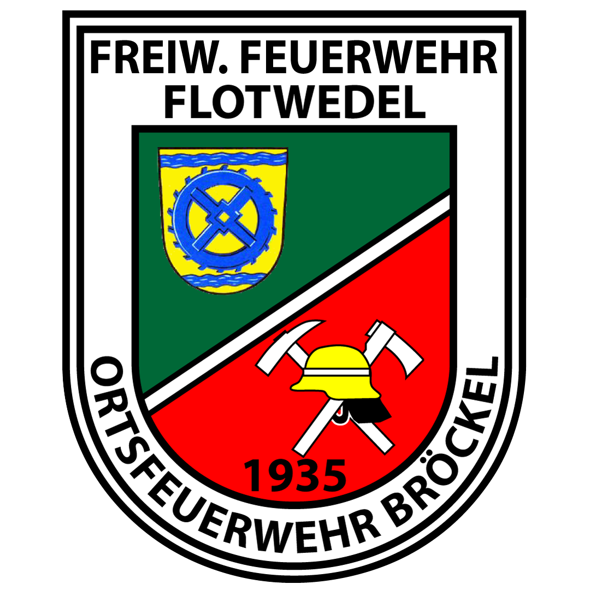{ width="300" }

[Originaldatei herunterladen (PNG)](assets/corporate-identity/logos/of-broeckel-wappen.png)

Die Beschriftung ist Bestandteil des Wappens und bleibt unverändert. Für Texte außerhalb des Wappens gelten die oben aufgeführten erlaubten Namensformen. Das Wappen der Gemeinde und das Wappen der Samtgemeinde sind zusätzliche Referenzen; sie ersetzen das Wappen der Ortswehr nicht.

### Logo für digitale Anwendungen

Das Logo verwendet die Wortgestaltung **„FEUERWEHR BRÖCKEL“** mit einem Rahmen um „FEUERWEHR“. Die festgelegte Schrift ist **Open Sans Extra Bold**, die Primärfarbe **#DB1818**. Die Absenderdarstellung im öffentlichen Laternenumzug-Plakat zeigt dieses Gestaltungsmuster.

Die drei bereitgestellten SVG-Dateien sind unverändert hinterlegt. Sie haben jeweils eine Zeichenfläche von 762 × 196 und enthalten die jeweilige Hintergrundfläche. Die Buchstaben sind als Pfade enthalten; zur Darstellung der SVG-Dateien muss die Schrift nicht zusätzlich installiert werden. Das Logo aus der Originaldatei einsetzen, statt den Schriftzug neu zu setzen.

**Primärfarbe auf Weiß:**

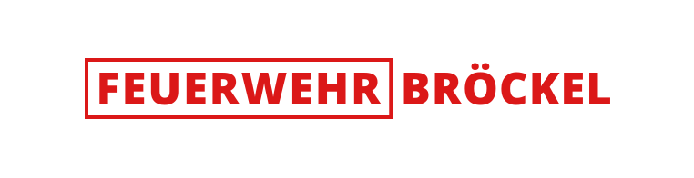{ width="480" }

[Originaldatei herunterladen (SVG)](assets/corporate-identity/logos/of-broeckel-logo.svg)

**Weiß auf Primärfarbe:**

{ width="480" }

[Originaldatei herunterladen (SVG)](assets/corporate-identity/logos/of-broeckel-logo-on-red.svg)

**Weiß auf Grau:**

{ width="480" }

[Originaldatei herunterladen (SVG)](assets/corporate-identity/logos/of-broeckel-logo-on-grey.svg)

Die graue Fläche #7A7A7A (RGB 122, 122, 122) ist Bestandteil dieser Logovariante; daraus folgt keine Festlegung als allgemeine Sekundärfarbe. Die Logo-Schrift legt auch nicht automatisch die Schrift aller Veranstaltungstitel fest. Genaue Positionen, Schutzräume und Einsatzregeln außerhalb der gezeigten Anwendungen bleiben zu ergänzen.

### Wappen der Samtgemeinde Flotwedel

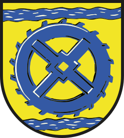{ width="220" }

[SVG-Datei herunterladen](assets/corporate-identity/logos/flotwedel-wappen.svg) · [Originaldatei auf flotwedel.de](https://www.flotwedel.de/static/bilder/layoutbilder/flotwedel_wapp.svg)

Die Originaldatei ist als lokale Kopie hinterlegt. Die Verwendung in Beiträgen der Feuerwehr, die Position und die Kombination mit weiteren Logos sind noch festzulegen. Die Farben des Wappens legen die Farbpalette der Feuerwehr nicht automatisch fest.

### Wappen der Gemeinde Bröckel

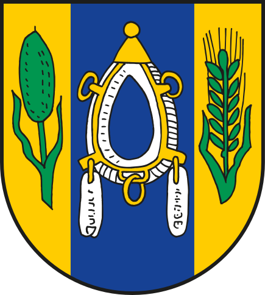{ width="220" }

[SVG-Datei herunterladen](assets/corporate-identity/logos/broeckel-wappen.svg) · [Originaldatei auf flotwedel.de](https://www.flotwedel.de/static/bilder/layoutbilder/broeckel_wapp.svg)

Die Originaldatei ist als lokale Kopie hinterlegt. Die Verwendung in Beiträgen der Feuerwehr, die Position und die Kombination mit weiteren Logos sind noch festzulegen. Die Farben des Wappens legen die Farbpalette der Feuerwehr nicht automatisch fest.

### Favicon-Varianten

Die beiden bereitgestellten SVG-Dateien sind unverändert hinterlegt. Beide haben eine Zeichenfläche von 16 × 16 und zeigen „FB“ in einem quadratischen Rahmen. Sie dienen als Favicon-Varianten; ihre Verwendung als zusätzliches Gestaltungselement auf Plakaten ist noch festzulegen.

**Inverse Variante – weiße Darstellung auf roter Fläche:**

{ width="96" }

[Originaldatei herunterladen (SVG)](assets/corporate-identity/logos/favicon_inverse.svg)

**Weiße Variante – transparenter Hintergrund:**

{ width="96" style="background-color: #DB1818; padding: 12px;" }

[Originaldatei herunterladen (SVG)](assets/corporate-identity/logos/favicon_white.svg)

Die rote Fläche hinter der weißen Vorschau dient nur der Sichtbarkeit auf dieser Seite; die SVG-Datei selbst hat einen transparenten Hintergrund.

### Regeln für die Verwendung

Die folgenden Regeln sind Vorschläge zur Freigabe:

- Nur die freigegebene Originaldatei verwenden. Logo und Wappen nicht nachzeichnen, durch ein ähnliches Symbol ersetzen oder von einer Bild-KI neu erfinden lassen.
- Seitenverhältnis beibehalten; nicht verzerren, beschneiden oder drehen.
- Farben und Bestandteile nicht verändern. Keine zusätzlichen Schatten, Konturen oder Effekte hinzufügen.
- Ausreichenden Kontrast zum Hintergrund sicherstellen.

| Maß / Position | Festlegung |
| --- | --- |
| Schutzraum | [Abstand rund um das Logo; Bezugsgröße oder Pixelwert ergänzen] |
| Mindestgröße digital | [Breite in Pixeln ergänzen] |
| Bevorzugte Position | [Position und Abstand zum Bildrand ergänzen] |
| Zulässige Hintergründe | [Farben oder Bildhintergründe ergänzen] |

## Farben

Hier ausschließlich die tatsächlich festgelegten Farbwerte eintragen. Bildschirmdarstellung und Bildgenerierung richten sich nach den **HEX-Werten**. RGB-Werte müssen dazu passen; CMYK nur bei Bedarf für Druckmaterial ergänzen.

| Rolle | Farbname | HEX | RGB | Einsatz |
| --- | --- | --- | --- | --- |
| Primärfarbe | Rot | #DB1818 | 219, 24, 24 | Primärfarbe der Corporate Identity; als Hintergrund in der inversen Favicon-Variante enthalten. [Weitere Einsatzregeln ergänzen] |
| Sekundärfarbe | [Name] | [#RRGGBB] | [R, G, B] | [z. B. ergänzende Flächen] |
| Akzentfarbe | [Name] | [#RRGGBB] | [R, G, B] | [z. B. Hervorhebungen] |
| Hintergrund hell | [Name] | [#RRGGBB] | [R, G, B] | [Verwendung] |
| Hintergrund dunkel | [Name] | [#RRGGBB] | [R, G, B] | [Verwendung] |
| Textfarbe | [Name] | [#RRGGBB] | [R, G, B] | [Verwendung] |

**Zulässige Kombinationen:** [Text- und Hintergrundfarben sowie ggf. Farbanteile ergänzen]

**Nicht zulässig:** [Farben, Kombinationen oder Verläufe ergänzen]

**Interne Ankündigungen:** Weißer Hintergrund (`#FFFFFF`, RGB `255, 255, 255`) ist festgelegt. Im bereitgestellten Beispiel ist der Text schwarz; `#000000` (RGB `0, 0, 0`) dient als aus dem Beispiel abgeleiteter Arbeitswert. Die Farben des Originalwappens bleiben erhalten. Diese Festlegung gilt für interne Ankündigungen; neben der bestätigten Primärfarbe bleiben die weiteren Farben der allgemeinen Palette offen.

## Schriftarten

**Interne Ankündigungen:** Roboto ist die festgelegte Schriftfamilie, das Datum wird in **Roboto Thin** gesetzt. Die übrigen Schnitte werden unten anhand des Beispiels beschrieben; ihre exakten Gewichte sind noch zu bestätigen. Die folgende allgemeine Tabelle bleibt für andere Beitragsarten offen.

| Verwendung | Schriftfamilie | Schnitt / Gewicht | Datei oder Bezugsquelle |
| --- | --- | --- | --- |
| Digitales Logo | Open Sans | Extra Bold | Original-SVG-Dateien im Abschnitt „Logo für digitale Anwendungen“; [Fontdatei oder Bezugsquelle bei Bedarf ergänzen] |
| Überschriften | [Exakter Fontname] | [z. B. Bold / 700] | [Link ergänzen] |
| Fließtext | [Exakter Fontname] | [z. B. Regular / 400] | [Link ergänzen] |
| Datum, Uhrzeit und Hervorhebungen | [Exakter Fontname] | [Schnitt ergänzen] | [Link ergänzen] |
| Ersatzschrift | [Exakter Fontname] | [Schnitt ergänzen] | [Wann zulässig?] |

**Nutzung und Bereitstellung:** [Lizenz, erlaubte Nutzung und ggf. Erlaubnis zur öffentlichen Bereitstellung der Fontdateien ergänzen]

**Typografische Regeln:** [Groß-/Kleinschreibung, Ausrichtung, Größenverhältnis von Titel und Text sowie Zeilenabstände ergänzen]

## Bildsprache und Layout

| Merkmal | Festlegung |
| --- | --- |
| Bildstil | [Fotografie / Illustration / Kombination festlegen] |
| Motive | [Gewünschte Motive und lokale Bezüge ergänzen] |
| Bildwirkung | [z. B. authentisch, nahbar, ruhig – festlegen] |
| Fahrzeuge und Ausrüstung | [Referenzbilder und Anforderungen ergänzen] |
| Hintergrund | [Flächen, Fotos, Muster oder Verläufe festlegen] |
| Gestaltungselemente | [Rahmen, Linien, Icons oder Formen ergänzen] |
| Aufbau | [Positionen für Titel, Motiv, Veranstaltungsdetails und Logo ergänzen] |
| Randabstand | [Pixelwert oder Anteil am Format ergänzen] |
| Zu vermeiden | [Unerwünschte Motive, Stile und Effekte ergänzen] |

**Vorgeschlagene Grundregel:** Ein Hauptmotiv und eine klare Überschrift verwenden. Wichtige Informationen müssen auf dem Smartphone gut lesbar sein. Lange Erklärungen in den Begleittext auslagern.

### Interne Veranstaltungsankündigungen

Dieses Muster wird für Veranstaltungen verwendet, die die Feuerwehr ausrichtet, etwa **Osterfeuer, Laternenumzug, Oktoberfest und Scheunenfete**. Es informiert intern über Aufbau, offiziellen Beginn und Abbau.

**Bestätigte Vorgaben:** weißer Hintergrund, Schriftfamilie Roboto und Datum in Roboto Thin.

**Interpretation des bereitgestellten Beispiels „Laternenumzug 2025“:**

| Element | Beobachtete Gestaltung |
| --- | --- |
| Format | Quadrat; bereitgestelltes Beispiel mit 1080 × 1080 px |
| Wappen | Originalwappen oben links, mit Abstand zu oberem und linkem Rand; ungefähr ein Fünftel der Bildhöhe |
| Veranstaltungstitel | Groß und fett, rechts neben dem Wappen im oberen Bereich; Veranstaltungsname und Jahr in einer Zeile |
| Datum | Unter dem Titel, innerhalb des Bereichs rechts vom Wappen zentriert; Roboto Thin; Muster „Wochentag, TT.MM.JJJJ“ |
| Tagesüberschriften | Über die gesamte Bildbreite zentriert, fett und kursiv; z. B. „Freitag“ und „Samstag“ |
| Tätigkeiten | Links ausgerichtet, große leichte Schrift; z. B. „Aufbau“, „Beginn Laternenumzug“, „Abbau“ |
| Uhrzeiten | Rechtsbündig in einer gemeinsamen Spalte, auf derselben Grundlinie wie die Tätigkeit; Muster „HH:MM Uhr“ |
| Abstände | Viel Weißraum zwischen Kopfbereich und Ablauf sowie zwischen den Tagesblöcken; großzügige Außenränder |
| Weitere Gestaltung | Im Beispiel ausschließlich Wappen und Text; keine zusätzlichen Fotos, Rahmen oder Schmuckelemente |

Für den Titel ist ein fetter Roboto-Schnitt, für Tagesüberschriften ein fetter kursiver Schnitt erkennbar. Ob konkret Bold oder Black verwendet wurde und welcher leichte Schnitt für Tätigkeiten und Uhrzeiten gilt, lässt sich aus dem Bild nicht sicher bestimmen. Diese Details sowie genaue Schriftgrößen und Abstände sind noch zu ergänzen.

**Inhaltliches Muster:** Tagesblöcke in zeitlicher Reihenfolge anordnen. Pro Termin steht links die Tätigkeit und rechts die Uhrzeit. Aufbau, offizieller Beginn und Abbau können auf unterschiedliche Tage fallen. Zusätzliche Tage oder Tätigkeiten übernehmen dasselbe Muster. Bei langen Titeln oder vielen Terminen das Layout anpassen und die Lesbarkeit erhalten.

**Variable Inhalte:** Veranstaltungsname, Jahr, Veranstaltungsdatum, Wochentage, Tätigkeiten und Uhrzeiten kommen aus dem jeweiligen Auftrag. Die Daten des Beispiels nicht für neue Veranstaltungen übernehmen. Das Beispiel zeigt „Laternenumzug 2025“ mit „Freitag, 07.11.2025“; die erwähnte Ausgabe 2026 ist separat mit ihren eigenen Terminen zu befüllen.

### Varianten des internen Layouts

Die weiteren Beispiele bestätigen den gemeinsamen Kopfbereich mit Wappen oben links, fettem Titel und dünn gesetztem Datum. Der Inhaltsbereich richtet sich nach der Art der Information. Die folgenden Details sind aus den Bildern abgeleitet; exakte Schriftgrößen, Gewichte und Grauwerte bleiben offen.

| Variante | Gliederung und Ausrichtung | Beispiel |
| --- | --- | --- |
| Ablauf nach Tagen | Tagesüberschrift zentriert, fett und kursiv; darunter Tätigkeit links und Uhrzeit rechts | Laternenumzug; Osterfeuer mit Aufbau, Treffen, Beginn / Entzündung und Abbau |
| Aufbau und Abbau | Abschnittsüberschriften „Aufbau“ und „Abbau“ zentriert, fett und kursiv; darunter Wochentag links, Uhrzeit in einer mittleren Spalte und optional Ort oder Tätigkeit in einer dritten Spalte | Oktoberfest; Scheunenfete |
| Anfuhrtermine | Abschnittsüberschrift zentriert, fett und kursiv; links Wochentag mit Datum in Klammern, rechts Zeitspanne; Beginn separat groß, fett und zentriert im unteren Bereich | Osterfeuer: Anfuhrtermine |
| Allgemeine interne Mitteilung | Mehrzeiliger, linksbündiger Titel rechts neben dem Wappen; darunter Zeitraum und erklärender Text; wichtige Angaben fett hervorheben | Abmeldung über Schützenfest |

**Spalten:** Innerhalb eines Abschnitts gemeinsame Spaltenpositionen und Grundlinien verwenden. Die zweispaltige Variante hat rechtsbündige Uhrzeiten. In der dreispaltigen Variante stehen Uhrzeiten in einer eigenen mittleren Spalte; Ort oder Zusatzinformation folgen rechts. Tabellenlinien sind in den Beispielen nicht vorhanden.

**Hinweise:** Im Oktoberfest-Beispiel ist „unter Vorbehalt“ grau und kursiv gesetzt. Im Scheunenfete-Beispiel ist die komplette Zeile „Donnerstag – 18:00 Uhr – Halle reinigen“ grau gesetzt, ohne erkennbare Kursivierung. Grau kennzeichnet hier eine visuelle Abstufung; aus dem Bild allein lässt sich für die Scheunenfete kein besonderer Verbindlichkeitsstatus ableiten. Hinweise immer ausdrücklich benennen, statt ihre Bedeutung allein durch Farbe auszudrücken.

**Titel und Datum:** Lange Titel dürfen rechts neben dem Wappen über mehrere Zeilen laufen. Bei allgemeinen Mitteilungen kann die Datumszeile entfallen und der Zeitraum im Inhalt stehen. Die Beispiele verwenden sowohl zwei- als auch vierstellige Jahreszahlen und unterschiedliche Kommasetzung beim Datum; eine verbindliche einheitliche Schreibweise ist noch festzulegen.

**Längere Mitteilungen:** Zeitraum mit „Von:“ und „Bis:“ links und fett gesetzten Datums- und Zeitangaben daneben darstellen. Erklärungstext linksbündig setzen, zentrale Wörter gezielt fett hervorheben. Einen zusätzlichen Hinweis mit fettem „Hinweis:“ einleiten. Diese Variante ergänzt die Terminübersichten innerhalb derselben Gestaltung.

## Öffentliche Veranstaltungsplakate

**Zweck:** Aufmerksamkeit wecken, Lust auf die Veranstaltung machen und Publikum gewinnen. Öffentliche Plakate werden als Quadrat (1:1), im Hochformat 4:5 und 9:16 sowie für klassischen Print erstellt. Diese Anwendungen sind festgelegt; die folgenden Gestaltungshinweise sind Interpretationen der bereitgestellten Plakate für Scheunenfete, Laternenumzug und Osterfeuer und Teil dieses Entwurfs.

### Bildsprache und Informationshierarchie

| Element | Beobachtung am Beispiel „Scheunenfete Bröckel“ |
| --- | --- |
| Hintergrund | Bildfüllende, stimmungsvolle Partyszene in einer Scheune / Halle mit Publikum, Bühne, bunten Scheinwerfern, warmen Lichterketten und Konfetti |
| Wirkung | Feierlich, lebendig und einladend; die Veranstaltung wird durch Atmosphäre und Motiv vermittelt |
| Titel | Sehr groß, fett, schmal laufend, in Großbuchstaben und zentriert; „SCHEUNENFETE“ und „BRÖCKEL“ in zwei Zeilen oben |
| Schrift | Markante, stark verdichtete Schrift; die genaue Schriftfamilie ist noch zu bestimmen. Roboto ist für diese Plakate bislang nicht festgelegt |
| Farben | Dunkler Hintergrund, weiße Schrift und gelb-goldene Hervorhebung; bunte Bühnenlichter als Teil des Motivs. Exakte HEX-Werte bleiben offen |
| Effekte | Gelb-goldener Lichtschein um den Titel; leuchtende Hervorhebung des Datums |
| Datum | Sehr groß und zentriert im unteren Bereich; nach dem Titel das wichtigste Textelement |
| Veranstaltungsdetails | Uhrzeit und Eintritt kompakt in einer Zeile; Ortsangabe darunter, weiß und in Großbuchstaben |
| Veranstalter | Kleine, zentrierte Zeile am unteren Rand |
| Logo | Im Beispiel ist kein separates Feuerwehrlogo sichtbar. Ob und wo es auf öffentlichen Plakaten eingesetzt werden soll, bleibt offen |

**Vorgeschlagene Lesereihenfolge:** Veranstaltung und Ort → Datum → Uhrzeit, Eintritt und Veranstaltungsort → Veranstalter. Das Hauptmotiv vermittelt die Atmosphäre; Text bleibt auch über einem lebhaften Hintergrund gut lesbar. Bei Bedarf den Bereich hinter dem Text abdunkeln oder mit einem Verlauf beruhigen.

Die gezeigte Partyszene ist eine Referenz für die Scheunenfete. Für Osterfeuer, Laternenumzug oder andere Veranstaltungen ein zum Anlass passendes Motiv und eine passende Stimmung wählen. Aus dem Bild lässt sich nicht ableiten, ob es eine Aufnahme einer tatsächlichen Veranstaltung oder eine Illustration ist; ein erzeugtes Motiv nicht als dokumentarisches Veranstaltungsfoto ausgeben.

### Weitere öffentliche Gestaltungsvarianten

Die Beispiele zeigen unterschiedliche Ansätze je Veranstaltung. Ein bildfüllendes Foto, schmale Großbuchstaben oder ein Leuchteffekt sind keine allgemeine Pflicht für öffentliche Plakate. Die Primärfarbe ist #DB1818. Die genaue Schriftfamilie und die übrigen Farbwerte dieser Varianten sind noch zu bestätigen; Farbabweichungen in historischen Beispielen definieren keine zusätzlichen verbindlichen Farben.

| Element | Laternenumzug 2025 | Osterfeuer 2026 |
| --- | --- | --- |
| Grundaufbau | Quadratische Grafik mit ruhiger dunkelroter Farbfläche und dekorativen Symbolen | Hochformat 4:5 mit großem Feuermotiv und roten Informationsbändern |
| Absender | Oben links rote Wortgestaltung „FEUERWEHR BRÖCKEL“; „FEUERWEHR“ rechteckig eingerahmt | Veranstalter ausgeschrieben in einem eigenen roten Bereich unten |
| Titel | Sehr groß, fett, serifenlos, in Großbuchstaben und zentriert | Groß, fett, serifenlos und linksbündig im oberen roten Band; gemischte Groß-/Kleinschreibung |
| Termin | Datum und Uhrzeit groß und fett unter dem Titel; vollständiger Termin zusätzlich in der Informationsliste | Wochentag, Datum und Beginn direkt unter dem Titel, gefolgt vom Ort |
| Farben | Dunkelrot als Hintergrund, helle roséfarbene Schrift, kräftiges Rot für den Absender; gedämpft gelb-olivfarbene Dekoration | Kräftig rote Flächen und helle Schrift; warmes Orange des Feuers und kühler Dämmerungshimmel im Motiv |
| Motiv / Dekoration | Mond und sternartige Linienformen im oberen Bereich | Großes Osterfeuer mit Publikum im Vordergrund und Landschaft im Hintergrund |
| Informationen | Linksbündige Zeilen mit einheitlicher Textkante und einer eigenen Spalte für Kontursymbole: Uhr, Ortsmarkierung und Information | Unter dem Motiv zwei Spalten für Anfuhrtermine sowie Essen und Trinken; Veranstalterzeile darunter |
| Typografische Abstufung | Fetter Titel und Haupttermin; Details in leichterem Schnitt; mehrzeilige Zusatzinformationen | Fetter Titel, leichterer Schnitt für Datum und Ort; im unteren Bereich sichtbar monospaced gesetzte Details und kleine Überschriften in Großbuchstaben |
| Trennung / Effekte | Großzügige Abstände, schlichte Kontursymbole; keine fotografische Szene und kein sichtbarer Leuchteffekt | Helle horizontale Trennlinien zwischen Motiv und Farbflächen; gepunktete Trennung der unteren Informationsbereiche |
| Logo / Wappen | Digitales Logo als rote Wortgestaltung sichtbar; kein separates Wappen | Kein separates Logo oder Wappen sichtbar |

**Laternenumzug:** Die Mond- und Sternsymbole vermitteln eine abendliche Stimmung. Die Informationsliste beschreibt Termin, Treffpunkt, musikalische Begleitung und Verpflegung. Mehrzeilige Angaben bleiben an derselben Textkante ausgerichtet; die Symbole stehen separat links. Der vollständige Termin in der Liste muss mit dem hervorgehobenen Kurztermin übereinstimmen.

**Osterfeuer:** Das Motiv trägt die Atmosphäre, während rote Flächen die Angaben lesbar bündeln. Im oberen Band stehen Veranstaltung, Termin und Ort. Zusatzinformationen stehen unter dem Motiv. Anfuhrtermine sind öffentliche Veranstaltungsinformationen und dürfen nicht mit internen Aufbauterminen verwechselt werden. Bei Formatwechseln die Informationsblöcke neu anordnen, etwa untereinander statt nebeneinander, und die Veranstalterzeile lesbar halten.

### Anpassung an verschiedene Formate

Alle Fassungen verwenden dieselben bestätigten Veranstaltungsangaben und dieselbe erkennbare Gestaltung. Jede Fassung erhält eine eigene Anordnung von Motiv und Text; wichtige Angaben dürfen beim Formatwechsel nicht abgeschnitten oder verzerrt werden.

| Ausgabe | Arbeitsformat | Gestaltungshinweis |
| --- | --- | --- |
| Quadrat (1:1) | Vorschlag: 1080 × 1080 px | Kopfbereich und Motiv kompakter anordnen; Titel, Datum und Details gut lesbar halten |
| Hochformat (4:5) | Vorschlag: 1080 × 1350 px | Dem gezeigten Plakat entsprechend: Titel oben, Atmosphäre in der Mitte, Datum und Details unten |
| Hochformat (9:16) | Vorschlag: 1080 × 1920 px | Motiv vertikal erweitern oder neu komponieren; wichtige Texte mit Abstand zu Bedienelementen des Zielkanals platzieren. Konkrete Freiräume je Kanal festlegen |
| Print | [Endformat in Millimetern und Ausrichtung ergänzen] | Eigenes Drucklayout im gewünschten Endformat; Größen und Lesbarkeit für den geplanten Aushang prüfen |

Die bereitgestellten Plakate für Scheunenfete und Osterfeuer haben ein Originalformat von **3240 × 4050 px (4:5)**. Das Laternenumzug-Beispiel ist quadratisch (1080 × 1080 px). Diese Pixelmaße sind Eigenschaften der Beispiele und noch keine Druckfreigabe.

### Angaben für klassische Printplakate

Vor der Druckausgabe die Vorgaben des Druckdienstleisters eintragen. Ein Bildentwurf allein ist noch keine geprüfte Druckdatei.

| Angabe | Festlegung |
| --- | --- |
| Endformat und Ausrichtung | [z. B. gewünschtes DIN-Format oder Breite × Höhe in mm] |
| Beschnittzugabe | [Vorgabe der Druckerei in mm je Seite] |
| Sicherheitsabstand für Text und Logo | [Vorgabe in mm ergänzen] |
| Bildauflösung im Endformat | [Anforderung der Druckerei ergänzen] |
| Farbmodus und Farbprofil | [Vorgabe der Druckerei ergänzen] |
| Dateiformat / PDF-Anforderungen | [Vorgabe der Druckerei ergänzen] |
| Schriftbehandlung | [Anforderung an eingebettete Schriften oder Pfade ergänzen] |

Das Motiv bei gefordertem Beschnitt bis in die Beschnittfläche fortsetzen. Texte und gegebenenfalls Logos innerhalb des Sicherheitsabstands anordnen. Die finale Datei im Endformat auf lesbare Details, ausreichende Bildauflösung und korrekte Veranstaltungsangaben prüfen.

## Beitragsarten und Formate

Die folgenden Abmessungen sind vorgeschlagene Arbeitsformate, keine verbindlichen Plattformvorgaben. Gewünschte Formate und Abstände für den jeweiligen Kanal ergänzen.

| Beitragsart | Zielgruppe | Vorgeschlagenes Format | Inhalte |
| --- | --- | --- | --- |
| Öffentliches Veranstaltungsplakat | Öffentlichkeit | 1:1, 4:5 und 9:16; Pixelmaße siehe Abschnitt oben | Titel, Datum, Uhrzeit, Ort, Eintritt / Anmeldung und Veranstalter; stimmungsvolles Motiv |
| Veranstaltungsplakat für Print | Öffentlichkeit | [Endformat in mm ergänzen] | Dieselben bestätigten Veranstaltungsangaben; Druckanforderungen siehe Abschnitt oben |
| Allgemeine Ankündigung | Öffentlichkeit | Quadrat, 1080 × 1080 px (1:1) | Überschrift, Kernbotschaft, Handlungsaufforderung |
| Story / Status | [Zielgruppe ergänzen] | Hochformat, 1080 × 1920 px (9:16) | Kurzer Titel, wichtigste Informationen; Freiraum für Bedienelemente festlegen |
| Interne Veranstaltungsankündigung | Mitglieder / Helfende | Quadrat, 1080 × 1080 px (1:1), aus den Beispielen abgeleitet | Veranstaltungsname, Datum; Ablauf nach Tagen, Aufbau / Abbau oder Anfuhrtermine; siehe interne Layoutvarianten oben |
| Sonstige Mitgliederinformation | Mitglieder | Quadrat, 1080 × 1080 px (1:1), aus dem Mitteilungsbeispiel abgeleitet; [Kanal ergänzen] | Anlass, ggf. Zeitraum, Erklärung und hervorgehobener Hinweis |

**Öffentlich oder intern:** [Festlegen, welche Inhalte für welchen Kanal bestimmt sind. Auf dieser öffentlichen Referenzseite nur zur Veröffentlichung vorgesehene Beispiele hinterlegen.]

## Beispiele und Referenzbilder

Für jedes Beispiel ein Bild und eine kurze Erklärung ergänzen. Angeben, ob es eine **verbindliche Gestaltungsvorlage** oder eine **Inspiration** ist. Bei Abweichungen gelten die ausdrücklich festgelegten Regeln auf dieser Seite; ein Beispiel führt keine zusätzliche Schrift oder Farbe ein.

### Öffentliches Plakat: Scheunenfete Bröckel 2026

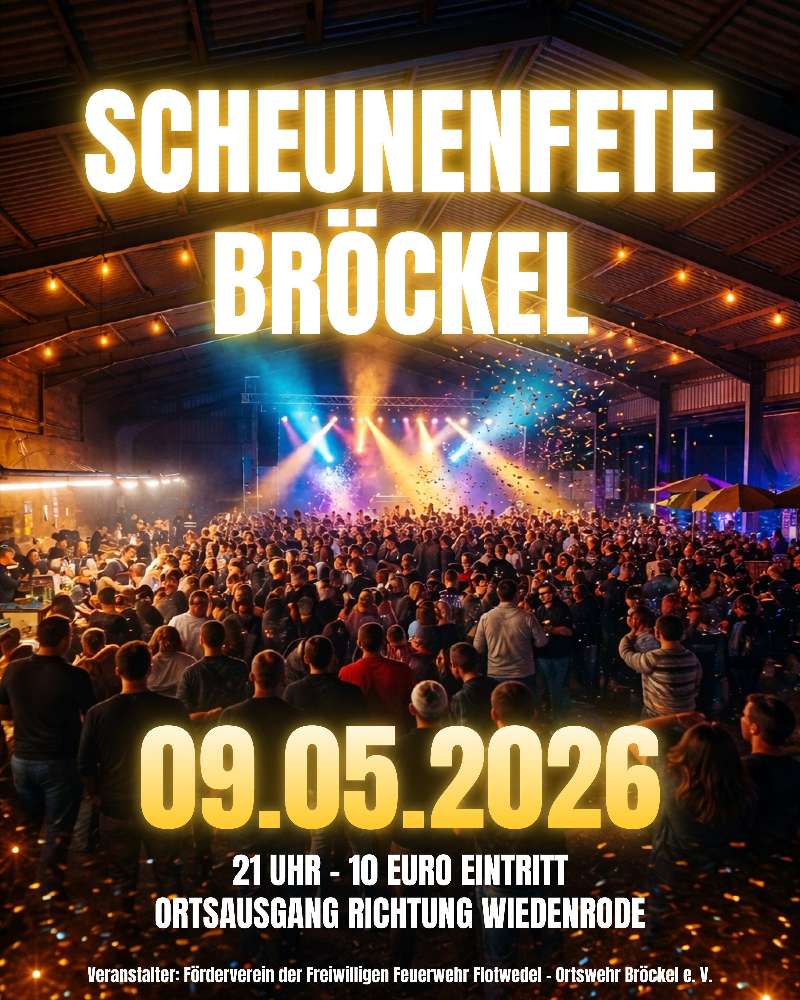{ width="480" loading=lazy }

[Originalplakat herunterladen (PNG, 3240 × 4050 px)](assets/corporate-identity/examples/Scheunenfete_2026_Plakat.png)

- **Status:** Gestaltungsreferenz; Interpretation im Abschnitt „Öffentliche Veranstaltungsplakate“. Schriftfamilie und exakte Farben sind noch offen.
- **Übernehmen:** Bildfüllende Atmosphäre, markanter großer Titel, hervorgehobenes Datum und kompakte Veranstaltungsdetails.
- **Anpassen:** Motiv passend zum Anlass, Veranstaltungstitel, Datum, Uhrzeit, Eintritt, Veranstaltungsort, Veranstalter und Layout je Ausgabeformat.

Das Beispiel nennt „09.05.2026“, „21 Uhr – 10 Euro Eintritt“ und „Ortsausgang Richtung Wiedenrode“. In der Veranstalterzeile steht „Förderverein der Freiwilligen Feuerwehr Flotwedel - Ortswehr Bröckel e. V.“. Diese Angaben beschreiben ausschließlich das historische Beispiel; der Vereinsname ist als Wortlaut aus dem Plakat dokumentiert und noch nicht als offizielle Bezeichnung in der Identitätstabelle bestätigt.

### Öffentliches Plakat: Laternenumzug 2025

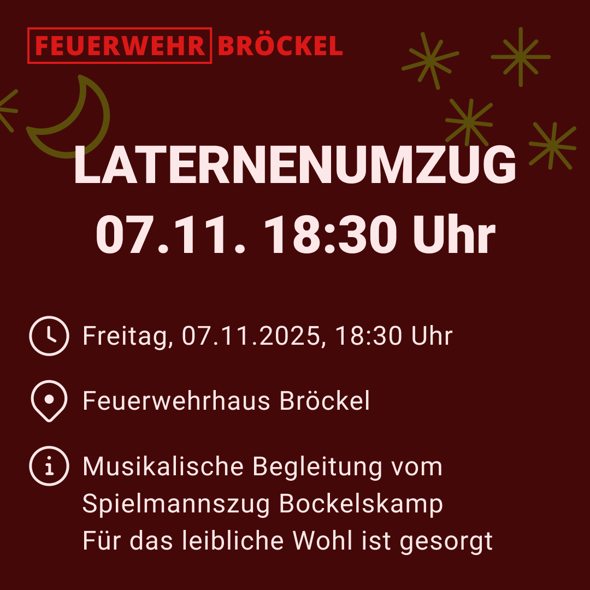{ width="480" loading=lazy }

[Originalplakat herunterladen (PNG, 1080 × 1080 px)](assets/corporate-identity/examples/Laternenumzug_2025_Post.png)

- **Status:** Gestaltungsreferenz; Farbflächen, Symbolspalte und Typografie sind im Abschnitt „Weitere öffentliche Gestaltungsvarianten“ beschrieben.
- **Übernehmen:** Dunkelrote Fläche, Mond-/Sterndekoration, großer Titel und Termin sowie Informationszeilen mit Kontursymbolen.
- **Anpassen:** Titel, Termin, Treffpunkt, musikalische Begleitung und Verpflegungsangaben.

Das Beispiel nennt „Freitag, 07.11.2025, 18:30 Uhr“, „Feuerwehrhaus Bröckel“, die musikalische Begleitung vom Spielmannszug Bockelskamp und „Für das leibliche Wohl ist gesorgt“. Diese Angaben sind historische Beispieldaten.

### Öffentliches Plakat: Osterfeuer Bröckel 2026

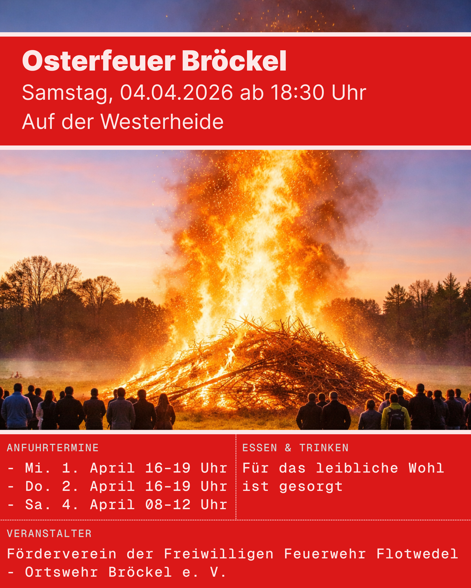{ width="480" loading=lazy }

[Originalplakat herunterladen (PNG, 3240 × 4050 px)](assets/corporate-identity/examples/Osterfeuer_2026_Plakat.png)

- **Status:** Gestaltungsreferenz; Interpretation im Abschnitt „Weitere öffentliche Gestaltungsvarianten“.
- **Übernehmen:** Großes Motiv, rote Informationsbänder, linksbündiger Kopftext, zweispaltige Zusatzinformationen und eigener Veranstalterbereich.
- **Anpassen:** Titel, Datum, Beginn, Ort, Anfuhrtermine, Verpflegung und bestätigter Veranstaltername.

Das Beispiel nennt „Samstag, 04.04.2026 ab 18:30 Uhr“, „Auf der Westerheide“ sowie Anfuhrtermine am 1., 2. und 4. April. Diese Angaben sind historische Beispieldaten und keine Vorgaben für kommende Veranstaltungen.

### Interne Veranstaltungsankündigung: Laternenumzug

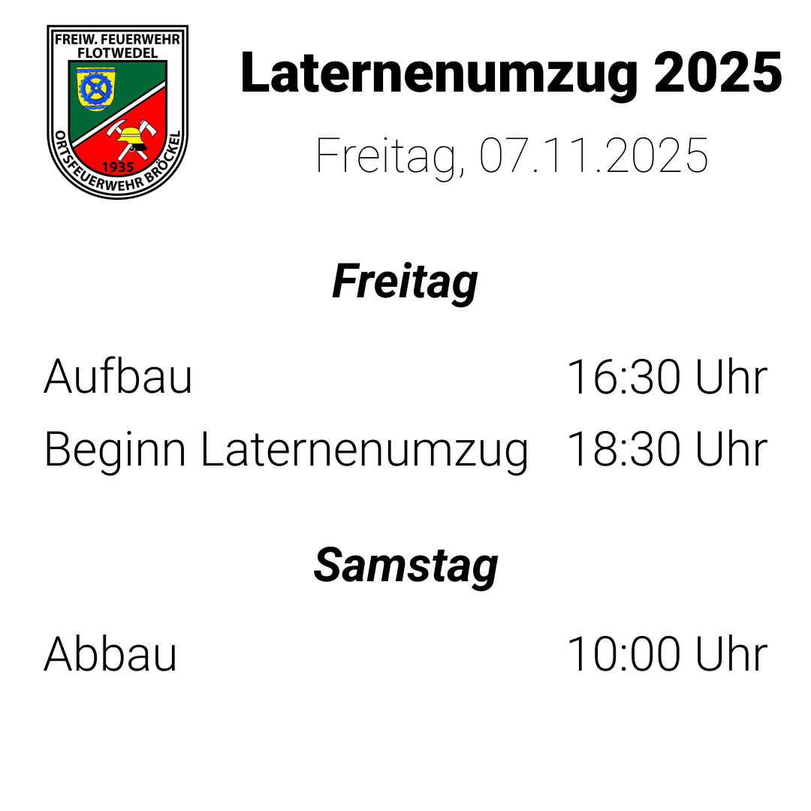{ width="480" loading=lazy }

[Originalbild herunterladen (PNG)](assets/corporate-identity/examples/Laternenumzug_2025_Aufbau_Abbau.png)

- **Status:** Bestehendes Gestaltungsbeispiel; Interpretation im Abschnitt „Interne Veranstaltungsankündigungen“. Weißer Hintergrund, Roboto und Roboto Thin für das Datum sind bestätigt.
- **Übernehmen:** Wappen oben links, Titel und Datum im Kopfbereich, zentrierte Tagesüberschriften und Ablauf mit Tätigkeiten links und Uhrzeiten rechts.
- **Anpassen:** Veranstaltungsname, Jahr, Datum, Wochentage, Tätigkeiten und Uhrzeiten.

Im Beispiel stehen am Freitag „Aufbau – 16:30 Uhr“ und „Beginn Laternenumzug – 18:30 Uhr“, am Samstag „Abbau – 10:00 Uhr“. Diese Angaben dokumentieren ausschließlich das Beispiel aus 2025.

### Weitere interne Gestaltungsbeispiele

Die folgenden Bilder zeigen bestehende Gestaltungsbeispiele. **Alle Termine und Veranstaltungsangaben sind historische Beispieldaten und müssen für neue Beiträge ersetzt werden.** Die Gestaltung ist oben beschrieben; Vorschauen und Originaldateien folgen unter der Übersicht.

| Beispiel | Übernehmen | Variable Inhalte |
| --- | --- | --- |
| Oktoberfest 2025 | Aufbau-/Abbau-Blöcke, drei Spalten für Tag, Uhrzeit und Ort; grauer kursiver Vorbehalt | Titel, Datum, Tage, Uhrzeiten, Ort und Wortlaut des Vorbehalts |
| Osterfeuer 2025 – Anfuhrtermine | Wochentag mit Datum in Klammern, Zeitspannen rechts; Beginn separat fett unten | Anfuhrtage, Zeitspannen und Veranstaltungsbeginn |
| Osterfeuer 2025 – Ablauf | Tagesblöcke mit mehreren Tätigkeiten; eigener Block für Abbau am Folgetag | Tage, Tätigkeiten und Uhrzeiten |
| Scheunenfete 2026 | Aufbau-/Abbau-Blöcke, mehrere Aufbautage; optionale dritte Spalte und grau abgestufte Zusatzzeile | Datum, Tage, Uhrzeiten, Zusatzaufgabe und deren Kennzeichnung |
| Abmeldung über Schützenfest 2023 | Mehrzeiliger Titel, Von-/Bis-Zeilen, erklärender Text und hervorgehobener Hinweis | Anlass, geprüfter Zeitraum, Vertretung und Hinweistext |

**Prüfung des Mitteilungsbeispiels:** Das Bild nennt als Beginn „06.07.2023 16:00 Uhr“ und als Ende „10.06.2023 13:00 Uhr“. Damit liegt das abgebildete Ende vor dem Beginn. Der Zeitraum ist widersprüchlich und darf nicht ungeprüft übernommen oder eigenständig korrigiert werden. Das Beispiel dient hier nur als Layoutreferenz; sein Text beschreibt keine aktuelle Abmeldung oder Einsatzbereitschaft.

Das Schützenfest-Beispiel wird wegen dieser widersprüchlichen Datumsangaben hier vorerst nicht als Bild eingebunden.

#### Oktoberfest 2025 – Aufbau und Abbau

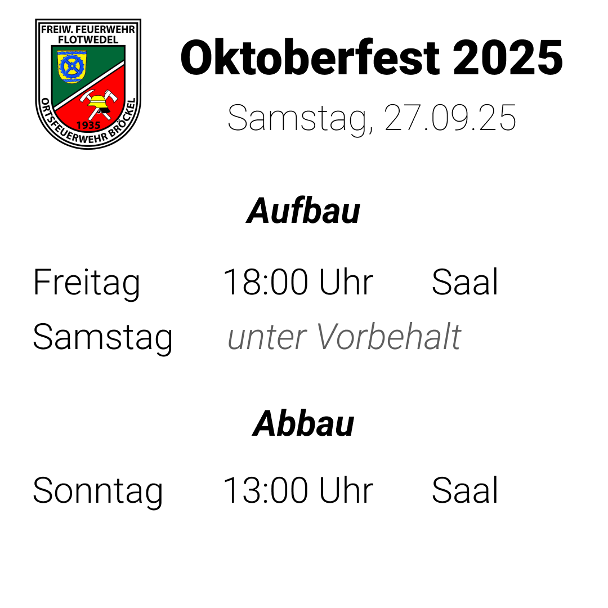{ width="480" loading=lazy }

[Originalbild herunterladen (PNG)](assets/corporate-identity/examples/Oktoberfest_2025_Aufbau_Abbau.png)

Das Beispiel zeigt die dreispaltige Variante und die Kennzeichnung „unter Vorbehalt“.

#### Osterfeuer 2025 – Anfuhrtermine

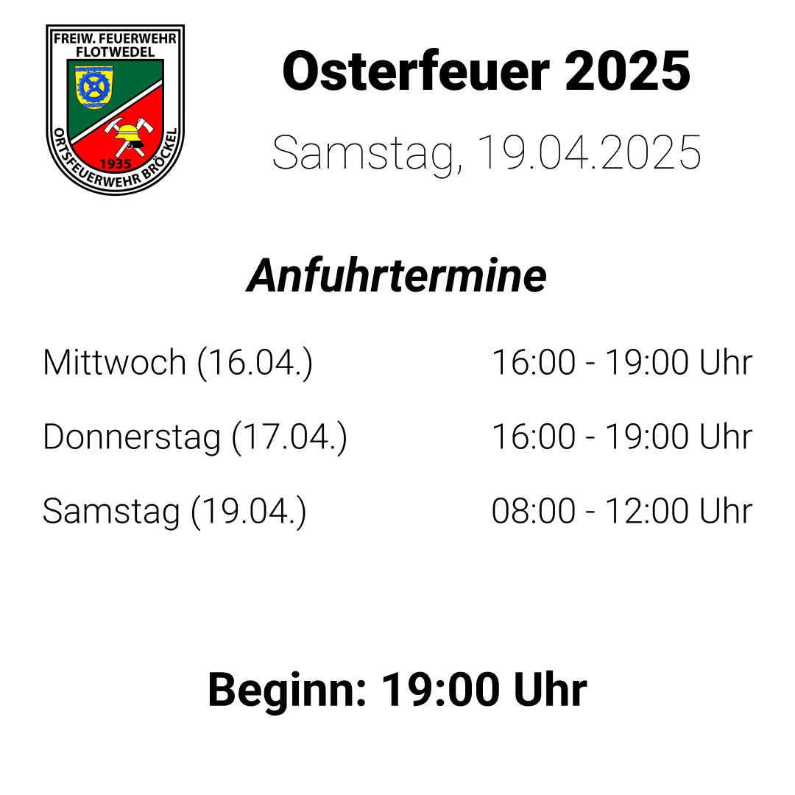{ width="480" loading=lazy }

[Originalbild herunterladen (PNG)](assets/corporate-identity/examples/Osterfeuer_2025_Anfuhrtermine.png)

Das Beispiel zeigt Zeitspannen und einen eigenen hervorgehobenen Beginn unter der Terminliste.

#### Osterfeuer 2025 – Ablauf

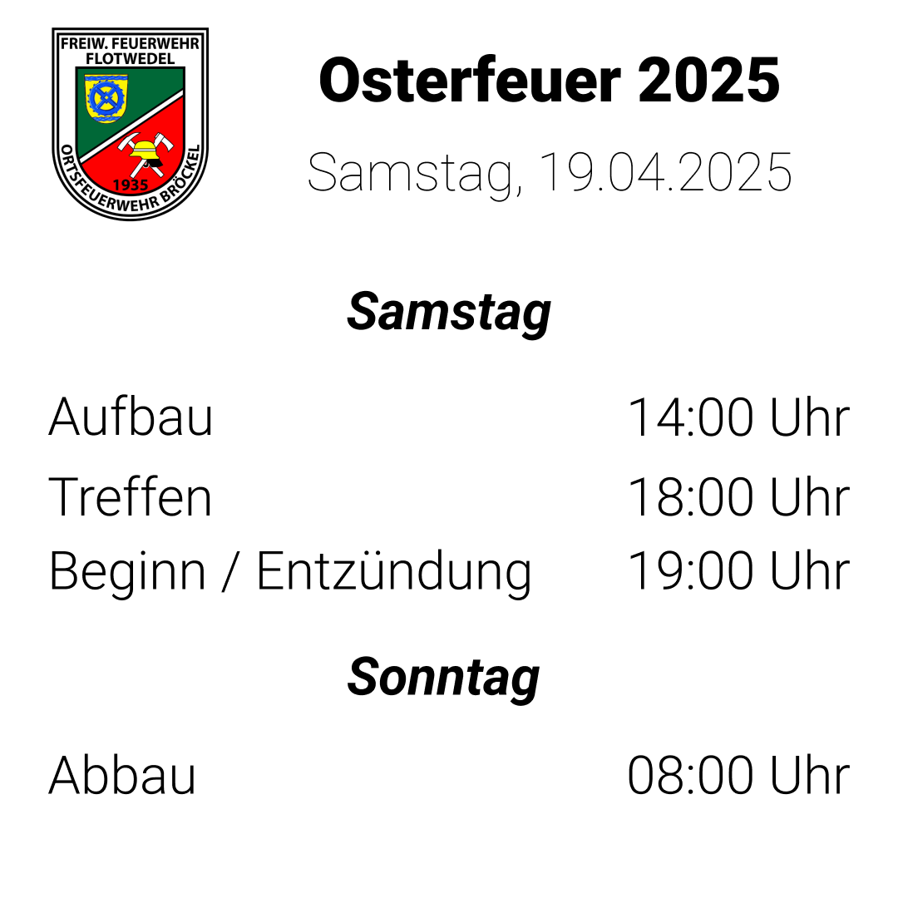{ width="480" loading=lazy }

[Originalbild herunterladen (PNG)](assets/corporate-identity/examples/Osterfeuer_2025_Aufbau_Abbau.png)

Das Beispiel zeigt mehrere Tätigkeiten innerhalb eines Tagesblocks und den Abbau am Folgetag.

#### Scheunenfete 2026 – Aufbau und Abbau

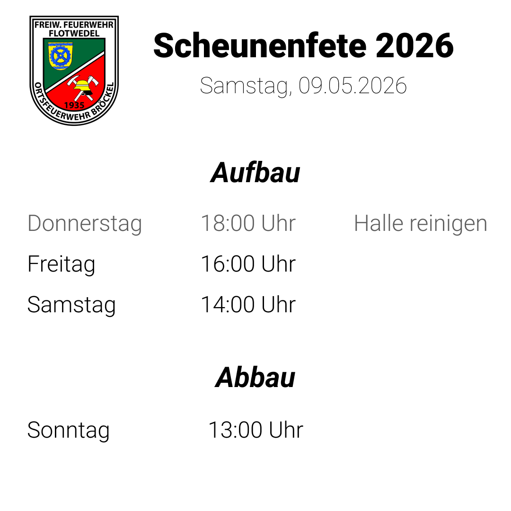{ width="480" loading=lazy }

[Originalbild herunterladen (PNG)](assets/corporate-identity/examples/Scheunenfete_2026_Aufbau_Abbau.png)

Das Beispiel zeigt zusätzliche Aufgaben in einer dritten Spalte und eine grau abgestufte Zeile.

### Unerwünschte Gestaltung

[Optional ein Gegenbeispiel ergänzen]

**Warum unerwünscht:** [Konkrete Abweichungen beschreiben]

## Vorlage für einen Auftrag an ChatGPT

Den folgenden Text kopieren und die Angaben in eckigen Klammern ersetzen. Die öffentliche URL verweist auf diese Seite; die benötigten Originaldateien und Referenzbilder ebenfalls direkt verlinken oder dem Auftrag beifügen.

```text
Erstelle einen Bildentwurf für die Feuerwehr Bröckel.

Gestaltungsrichtlinien: [Öffentliche URL dieser Seite]
Logo / Wappen: [Passende Originaldatei angeben: digitales Logo oder Ortswehrwappen]
Referenzbilder: [Direkte Links oder beigefügte Bilder]

Lies die Gestaltungsrichtlinien und orientiere dich an den dort
freigegebenen Farben, Schriften, Layoutregeln und Referenzen.
Werte in eckigen Klammern sind offene Angaben, keine Vorgaben.
Wenn die Seite oder eine benötigte Datei nicht zugänglich ist,
sage das und bitte um die betreffenden Inhalte.
Wenn wesentliche Vorgaben fehlen oder widersprüchlich sind,
frage nach, bevor du sie selbst festlegst.

Beitragsart: [Veranstaltung / Mitgliederinformation / andere]
Zielgruppe: [Zielgruppe]
Kanal: [Kanal]
Format: [Breite × Höhe in Pixeln und Seitenverhältnis]
Bei öffentlichen Plakaten:
Ausgaben: [1:1 / 4:5 / 9:16 / Print; gewünschte Varianten angeben]
Eintritt / Anmeldung: [Exakter Wortlaut oder entfällt]
Veranstalter: [Bestätigter Name]
Motiv und Stimmung: [Zum Anlass passende Beschreibung]
Plakatschrift: [Bestätigte Schriftfamilie und Schnitt]
Gestaltungsvariante: [Scheunenfete mit Partymotiv / Laternenumzug
mit Farbfläche und Symbolen / Osterfeuer mit Motiv und Informationsbändern]
Gestalte jede Formatvariante mit eigener Anordnung von Motiv und Text.
Nutze die dokumentierte öffentliche Plakatgestaltung als Referenz.
Für Print: [Endformat in mm, Beschnitt, Sicherheitsabstand, Auflösung,
Farbprofil und Dateianforderungen der Druckerei ergänzen]
Überschrift: [Exakter Wortlaut]
Datum: [Datum oder entfällt]
Uhrzeit: [Uhrzeit oder entfällt]
Ort: [Ort oder entfällt]
Weitere Angaben: [Eintritt, Anmeldung, Frist usw. oder entfällt]
Bei internen Veranstaltungsankündigungen:
Layoutvariante: [Ablauf nach Tagen / Aufbau und Abbau / Anfuhrtermine]
Ablauf: [Je Eintrag Datum/Wochentag, Tätigkeit, Uhrzeit oder Zeitspanne,
ggf. Ort und ausdrücklichen Hinweis angeben]
Verwende das dokumentierte interne Layout mit weißem Hintergrund,
Roboto, Datum in Roboto Thin und Ortswehrwappen oben links. Verwende gemeinsame
Spalten und Grundlinien entsprechend der gewählten Layoutvariante.
Bei allgemeinen internen Mitteilungen:
Zeitraum: [Geprüfter Beginn und geprüftes Ende oder entfällt]
Erklärung: [Exakter Wortlaut]
Hinweis: [Exakter Wortlaut oder entfällt]
Handlungsaufforderung: [Exakter Wortlaut oder entfällt]
Gewünschtes Motiv: [Beschreibung]

Erfinde keine Veranstaltungsdetails. Übernimm vorgegebene Texte exakt.
Prüfe Datumsangaben, zugehörige Wochentage und die Reihenfolge von
Beginn und Ende. Frage bei Widersprüchen nach; korrigiere sie nicht
eigenständig und übernimm keine historischen Termine aus Referenzbildern.
Verwende die gewählte Logo- oder Wappendatei unverändert. Für interne
Ankündigungen verwende das Ortswehrwappen; für die digitale
Absenderdarstellung das passende digitale Logo. Falls du die Datei nicht
exakt einsetzen kannst, lasse die vorgesehene Fläche frei und weise
darauf hin, dass sie anschließend aus der Originaldatei einzufügen ist.
Weise auch darauf hin, falls die vorgegebene Schrift oder die Texte
nicht exakt umgesetzt werden konnten.
```

## Dateien und Bilder ergänzen

Die zugehörigen Dateien werden im Repository unter `docs/assets/corporate-identity/` abgelegt. Empfohlene Struktur:

```text
docs/assets/corporate-identity/
├── logos/       # Freigegebene Originaldateien und Varianten
├── fonts/       # Fontdateien, sofern öffentlich bereitstellbar
└── examples/    # Gestaltungsbeispiele und Referenzbilder
```

Nach dem Hinzufügen einer Datei hier die Vorschau und einen Download-Link eintragen. Beispiel für ein Logo (erst einsetzen, wenn die Datei vorhanden ist):

```markdown


[Originallogo herunterladen](assets/corporate-identity/logos/of-broeckel-logo.svg)
```

Für Beispiele dasselbe Muster mit einem Pfad wie `assets/corporate-identity/examples/veranstaltung.png` verwenden. Aussagekräftige Bildbeschreibungen ergänzen und die gewünschten Gestaltungsmerkmale zusätzlich im Text erklären.

## Prüfen und freigeben

- [ ] Namen, Ansprache und Geltungsbereich festgelegt.
- [ ] Logo und Varianten hochgeladen, verlinkt und mit Verwendungsregeln versehen.
- [ ] Exakte Farbwerte und Schriftarten ergänzt.
- [ ] Bildsprache, Layout und Formate festgelegt.
- [ ] Beispiele ergänzt und als Vorlage oder Inspiration gekennzeichnet.
- [ ] Alle Platzhalter ersetzt oder ausdrücklich als „nicht verwendet“ markiert.
- [ ] Öffentliche Seiten-URL eingetragen und Datei-Links geprüft.
- [ ] Version, Datum und Freigabe eingetragen; Entwurfshinweis entsprechend angepasst.

Bei jedem erstellten Beitrag vor der Veröffentlichung Texte, Termine, Logo, Schrift und Farben mit den freigegebenen Vorgaben abgleichen.
